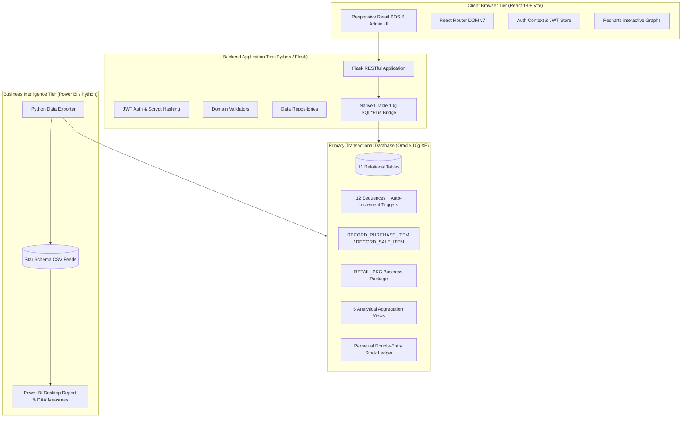
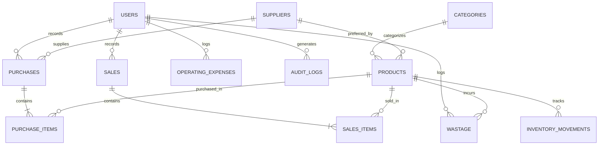

# Smart Retail Sales, Inventory & Profit Analytics System

[](LICENSE)
[](database/)
[](backend/)
[](frontend/)
[](backend/tests/)

> A full-stack, enterprise-grade business intelligence and retail operations platform tailored for independent grocery, vegetable, and fruit shops. Powered by **Oracle Database 10g XE**, **Python Flask REST API**, **React 18 + Vite**, and **Microsoft Power BI**.

---

## Table of Contents

1. [Executive Summary & Problem Statement](#1-executive-summary--problem-statement)
2. [Key Business Questions Answered](#2-key-business-questions-answered)
3. [End-to-End System Architecture](#3-end-to-end-system-architecture)
4. [Technology Stack](#4-technology-stack)
5. [Database Architecture & Oracle 10g Compatibility](#5-database-architecture--oracle-10g-compatibility)
6. [Double-Entry Perpetual Inventory Ledger](#6-double-entry-perpetual-inventory-ledger)
7. [Cost Accounting & Financial Formulations](#7-cost-accounting--financial-formulations)
8. [Role-Based Access Control (Admin vs. Staff)](#8-role-based-access-control-admin-vs-staff)
9. [Day-in-the-Life Operational Walkthrough](#9-day-in-the-life-operational-walkthrough)
10. [Frontend Application Modules](#10-frontend-application-modules)
11. [Backend RESTful API Reference](#11-backend-restful-api-reference)
12. [Business Intelligence & Power BI Integration](#12-business-intelligence--power-bi-integration)
13. [Installation & Setup Guide](#13-installation--setup-guide)
14. [Automated Testing & Verification](#14-automated-testing--verification)
15. [Troubleshooting & Compatibility FAQ](#15-troubleshooting--compatibility-faq)

---

## 1. Executive Summary & Problem Statement

Small, independent neighborhood grocery, fruit, and vegetable shops operate in high-velocity, low-margin, and perishable environments. Unlike traditional dry-goods retail:
- **Produce costs fluctuate daily** based on wholesale agricultural mandi pricing.
- **Produce spoils rapidly**, leading to shrinkage that distorts paper-based profit records.
- **Fast evening sales closing** is critical; cashiers cannot scan individual barcodes during rush hours and need a fast table-based entry mode to record total quantities sold.
- **Overstating profit** occurs when owners mistake gross cash collections for net profit without deducting true Cost of Goods Sold (COGS), perishable wastage, or store overhead expenses.

The **Smart Retail Sales, Inventory & Profit Analytics System** resolves these challenges by combining strict relational transactional integrity in **Oracle Database** with a lightning-fast **React web interface**, automated **moving weighted-average cost accounting**, and analytical **Power BI dashboards**.

---

## 2. Key Business Questions Answered

| Business Question | System Solution | Module / View |
|---|---|---|
| *How much did I sell today?* | Live daily sales total calculation with category subtotals | [Daily Sales Page](frontend/src/pages/DailySalesPage.jsx), `VW_DAILY_SALES_SUMMARY` |
| *Which items generated the highest gross profit?* | Line-by-line COGS deduction using moving-average cost basis | [Dashboard Page](frontend/src/pages/DashboardPage.jsx), `VW_PRODUCT_PERFORMANCE` |
| *Which vegetable sold the highest quantity?* | Ranked volume analytics filtered by category | [Reports Page](frontend/src/pages/ReportsPage.jsx), Power BI Product Matrix |
| *Which fruit generated the highest revenue?* | Revenue ranking filtered by category | [Dashboard Page](frontend/src/pages/DashboardPage.jsx), `VW_CATEGORY_PERFORMANCE` |
| *How much stock remains right now?* | Real-time perpetual inventory valuation | [Inventory Page](frontend/src/pages/InventoryPage.jsx), `VW_INVENTORY_VALUATION` |
| *Which items should I purchase tomorrow?* | Replenishment recommendation: $\max(0, 2 \times \text{Reorder} - \text{Stock})$ with supplier contacts | [Low-Stock Page](frontend/src/pages/LowStockPage.jsx), `VW_LOW_STOCK_ALERTS` |
| *How much stock was wasted or spoiled?* | Financial loss tracking with spoilage reasons | [Wastage Page](frontend/src/pages/WastagePage.jsx), `WASTAGE` |
| *What was my true net profit this month?* | Net profit formula: $\text{Gross Profit} - \text{OPEX} - \text{Wastage}$ | [Dashboard Page](frontend/src/pages/DashboardPage.jsx), `VW_MONTHLY_FINANCIAL_SUMMARY` |
| *How does this month compare with last month?* | MoM variance tracking for revenue, units, and margin | Python `period_comparison.py`, Power BI Time Intelligence |

---

## 3. End-to-End System Architecture



---

## 4. Technology Stack

- **Database:** Oracle Database 10g Express Edition Release 10.2.0.1.0 (`localhost:1521/XE`).
- **Backend API:** Python 3.13, Flask 3.1, Flask-CORS, PyJWT, Scrypt password hashing, Pytest.
- **Frontend SPA:** React 18, Vite 8, React Router v7, Axios, Recharts, Lucide Icons.
- **Data Analytics:** Python Pandas, NumPy, native Python automated validator.
- **Business Intelligence:** Microsoft Power BI Desktop, Star Schema CSV data feeds, DAX measures.

---

## 5. Database Architecture & Oracle 10g Compatibility

Oracle Database remains the **exclusive, non-replaceable primary transactional store**. To maintain 100% compatibility with **Oracle 10g XE**:

1. **Sequences & Triggers instead of 12c `IDENTITY`:**
   Every primary key is driven by an explicit Oracle sequence (`SEQ_<TABLE>_ID`) and a `BEFORE INSERT OR UPDATE` PL/SQL trigger.
2. **`ROWNUM` Subqueries instead of 12c `FETCH FIRST`:**
   Top-selling product rankings and historical paginations use the ANSI-compliant Oracle 10g `ROWNUM` pattern.
3. **Escaped Ampersands:**
   Scripts configure `SET DEFINE OFF;` to prevent SQL*Plus from prompting for variable substitutions when handling categories like `'Dairy & Bakery'`.
4. **Native Transactional Bridge:**
   Because modern 64-bit `python-oracledb` Thin mode rejects Oracle 10g with error `DPY-3010`, the backend uses a high-performance transactional SQL*Plus bridge (`backend/app/repositories/oracle_db.py`) executing with pipe-delimited outputs (`COLSEP '|~|'`).
5. **Increased Process Limits:**
   Configured `PROCESSES=150` and `SESSIONS=170` in SPFILE to prevent listener handler exhaustion (`ORA-12516`) under high-concurrency automated testing.

### Entity-Relationship Diagram



---

## 6. Double-Entry Perpetual Inventory Ledger

Every stock-affecting operation in the store writes an immutable audit record to the `INVENTORY_MOVEMENTS` table:

| Movement Type | Stock Delta | Accounting Source |
|---|---|---|
| `OPENING_STOCK` | Positive ($+$) | Initial product inventory setup |
| `PURCHASE` | Positive ($+$) | Inward supplier delivery (`PURCHASE_ITEMS`) |
| `SALE` | Negative ($-$) | End-of-day sales closing (`SALES_ITEMS`) |
| `WASTAGE` | Negative ($-$) | Perishable spoilage or damaged produce (`WASTAGE`) |
| `ADJUSTMENT` | Positive/Negative ($\pm$) | Physical stock audit count reconciliation |
| `SALE_REVERSAL` | Positive ($+$) | Authorized void of a previous sale |
| `PURCHASE_REVERSAL` | Negative ($-$) | Authorized return of a purchase delivery |

### Perpetual Reconciliation Audit
The system provides a real-time reconciliation check (`GET /api/inventory/reconcile`):
$$\text{Variance} = \text{PRODUCTS.CURRENT\_STOCK} - \sum \text{INVENTORY\_MOVEMENTS.QUANTITY\_CHANGE}$$
If $\text{Variance} = 0$, the inventory is mathematically balanced and certified auditable.

---

## 7. Cost Accounting & Financial Formulations

### Moving Weighted-Average Cost (MWAC)
When a new purchase arrives:
$$\text{New Unit Cost} = \frac{(\text{Current Stock} \times \text{Current Avg Cost}) + (\text{Inward Qty} \times \text{Inward Unit Cost})}{\text{Current Stock} + \text{Inward Qty}}$$

### Daily Sales & Profit
1. **Revenue:** $\sum (\text{Sold Quantity} \times \text{Selling Price})$
2. **COGS (Cost of Goods Sold):** $\sum (\text{Sold Quantity} \times \text{Unit Cost Basis at Sale Time})$
3. **Gross Profit:** $\text{Revenue} - \text{COGS}$
4. **Gross Margin \%:** $(\text{Gross Profit} / \text{Revenue}) \times 100$

### Net Store Profit
$$\text{Net Profit} = \text{Gross Profit} - \text{Perishable Wastage Cost} - \text{Operating Expenses (OPEX)}$$

> **Critical Rule:** Inward stock purchases are capitalized on the balance sheet as inventory assets; they are **never** treated as immediate expenses in the profit and loss statement until sold, spoiled, or written off.

---

## 8. Role-Based Access Control (Admin vs. Staff)

The system enforces strict server-side authorization:

| Feature / Workflow | Shop Owner (Admin) | Floor Cashier (Staff) |
|---|:---:|:---:|
| View Dashboard KPIs & Margin Visuals | Yes | Yes |
| Enter End-of-Day Sales Matrix | Yes | Yes |
| View Product Catalog & Stock Levels | Yes | Yes |
| Record Perishable Spoilage / Wastage | Yes | Yes |
| Add / Edit Products & Master Pricing | Yes | No |
| Record Inward Supplier Purchases | Yes | No (Unless authorized) |
| Reverse Sales or Purchase Transactions | Yes | No |
| Adjust Physical Stock Counts | Yes | No |
| Record Operating Overheads (OPEX) | Yes | No |
| User Account Provisioning & Roles | Yes | No |
| Download Financial BI Datasets | Yes | No |

---

## 9. Day-in-the-Life Operational Walkthrough

A complete operational day for the shop owner:

1. **07:00 AM — Morning Replenishment & Stock Check:**
   - The owner logs in and opens **Low-Stock Alerts** (`/low-stock`).
   - The system displays items below safety buffer levels with suggested order quantities and supplier contact numbers.
2. **09:30 AM — Receiving Inward Deliveries:**
   - Wholesale mandi deliveries arrive. The owner navigates to **Purchases** (`/purchases`), clicks **Record Inward Purchase**, enters items and unit costs.
   - Oracle PL/SQL updates on-hand stock and recalculates moving weighted-average costs atomically.
3. **08:30 PM — Fast Table Daily Sales Closing:**
   - Store closing time. The cashier or owner opens **Daily Sales Entry** (`/sales/daily`).
   - The active catalog is displayed in a spreadsheet-like matrix. The user types sold quantities.
   - The matrix calculates line totals, estimated COGS, and gross profit live. If an item exceeds available stock, the system displays a clear warning.
   - The user clicks **Submit Final Sales**. Oracle stores line items, deducts stock, and locks profit numbers.
4. **09:00 PM — Perishable Spoilage & Overhead Logging:**
   - The user records spoiled tomatoes or bruised bananas in **Wastage** (`/wastage`). Stock is written off.
   - The owner logs daily electricity or packaging costs in **Operating Expenses** (`/expenses`).
5. **09:15 PM — Reviewing Real-Time Profit:**
   - The owner checks the **Dashboard** (`/`) to review today's gross revenue, COGS, wastage loss, and bottom-line net profit.

---

## 10. Frontend Application Modules

The React frontend includes 10 purpose-built screens:

- **`LoginPage.jsx`:** Secure branded login with demo account shortcut pills.
- **`DashboardPage.jsx`:** Top KPI ribbon, 30-day sales trajectory area chart, category margin bar chart, and top profit drivers.
- **`DailySalesPage.jsx`:** Fast spreadsheet-like closing matrix with category filtering, real-time totals, draft auto-save, and overselling safeguards.
- **`SalesHistoryPage.jsx`:** Searchable audit trail of previous sales batches with line item inspection and authorized reversal.
- **`PurchasesPage.jsx`:** Inward delivery tracker with multi-item modal and moving average cost calculation.
- **`ProductsPage.jsx`:** Catalog manager with search, category filters, profit margin display, add/edit modal, and soft deactivation.
- **`InventoryPage.jsx`:** Real-time inventory valuation, double-entry stock movement ledger, physical adjustment modal, and audit reconciliation.
- **`LowStockPage.jsx`:** Reorder cards with stock buffer progress bars, deficit formulas, and supplier contacts.
- **`WastagePage.jsx`:** Spoilage logging modal with instant loss calculation and reason analytics.
- **`ExpensesPage.jsx`:** Overhead cost tracker with category breakdown and monthly P&L deduction.
- **`ReportsPage.jsx`:** Tabular BI views with print layout and live CSV export feeds.
- **`UsersPage.jsx`:** Admin user management with role toggles and active/inactive status controls.

---

## 11. Backend RESTful API Reference

All protected endpoints require the HTTP header `Authorization: Bearer <JWT_TOKEN>`.

### Authentication & Users
- `POST /api/auth/login` — Authenticate and receive JWT token.
- `GET /api/auth/me` — Get current user session.
- `GET /api/auth/users` — List personnel accounts *(Admin)*.
- `POST /api/auth/users` — Create staff or admin account *(Admin)*.
- `PUT /api/auth/users/<id>/status` — Activate/deactivate user account *(Admin)*.

### Products & Categories
- `GET /api/products` — Retrieve active product catalog with stock and costs.
- `POST /api/products` — Add a new product with opening inventory *(Admin)*.
- `PUT /api/products/<id>` — Update product details and prices *(Admin)*.
- `DELETE /api/products/<id>` — Deactivate product preserving historical transactions *(Admin)*.
- `GET /api/categories` — List product categories.

### Daily Sales
- `POST /api/sales/daily` — Submit end-of-day sales batch (draft or final).
- `GET /api/sales` — List historical sales batches with date filters.
- `GET /api/sales/<id>` — Get batch line items.
- `POST /api/sales/<id>/reverse` — Reverse finalized sale and restore stock *(Admin)*.

### Purchases
- `POST /api/purchases` — Record multi-item supplier shipment.
- `GET /api/purchases` — List inward purchase orders.
- `POST /api/purchases/<id>/reverse` — Reverse purchase order and deduct stock *(Admin)*.

### Inventory, Wastage & Overhead
- `GET /api/inventory` — Stock valuation per product and category.
- `GET /api/inventory/movements` — Journal ledger query for all stock changes.
- `POST /api/inventory/adjustments` — Physical audit count adjustment *(Admin)*.
- `GET /api/inventory/reconcile` — Mathematical ledger vs. master stock audit *(Admin)*.
- `GET /api/inventory/low-stock` — Stockout alerts and reorder quantities.
- `GET /api/inventory/wastage` — Wastage incident history.
- `POST /api/inventory/wastage` — Record spoilage write-off and deduct stock.
- `GET /api/expenses` — List operating overhead transactions.
- `POST /api/expenses` — Record overhead expense *(Admin)*.

### Analytics & Reports
- `GET /api/analytics/dashboard` — 30-day KPI ribbon and trajectory data.
- `GET /api/reports/daily-sales` — Daily closing analytical view.
- `GET /api/reports/monthly-sales` — Monthly financial summary view.
- `GET /api/reports/product-sales` — Product performance view.
- `GET /api/reports/category-sales` — Category performance view.
- `GET /api/reports/inventory` — Inventory valuation view.
- `GET /api/reports/wastage` — Spoilage view.
- `GET /api/reports/export?type=<report_type>` — Live CSV download for Power BI & Excel.

---

## 12. Business Intelligence & Power BI Integration

The system includes a dedicated Power BI ingestion and star schema model:

### Star Schema Architecture
- **Fact Tables:** `fact_daily_sales.csv`, `fact_purchases.csv`, `fact_wastage.csv`, `fact_inventory_movements.csv`, `fact_operating_expenses.csv`.
- **Dimension Tables:** `dim_products.csv`, `dim_categories.csv`, `dim_date.csv`.

### Key DAX Measures
```dax
Total Revenue = SUM(fact_daily_sales[LINE_REVENUE])
Total COGS = SUM(fact_daily_sales[LINE_COGS])
Gross Profit = [Total Revenue] - [Total COGS]
Gross Margin % = DIVIDE([Gross Profit], [Total Revenue], 0)
Total Wastage Cost = SUM(fact_wastage[TOTAL_COST])
Total Operating Expenses = SUM(fact_operating_expenses[AMOUNT])
Net Profit = [Gross Profit] - [Total Wastage Cost] - [Total Operating Expenses]
Inventory Valuation = SUMX(dim_products, dim_products[CURRENT_STOCK] * dim_products[PURCHASE_COST])
```

Documentation files in `powerbi/`:
- [`data_model.md`](powerbi/data_model.md) — Star schema relationships and data dictionary.
- [`dax_measures.md`](powerbi/dax_measures.md) — 11 DAX formulas.
- [`dashboard_specification.md`](powerbi/dashboard_specification.md) — 6-page interactive report layout spec.

To refresh all CSV feeds from Oracle:
```powershell
python python_analytics/export_datasets.py
```

---

## 13. Installation & Setup Guide

### Prerequisites
- Windows OS with Oracle Database 10g XE installed locally (`OracleServiceXE` on port 1521).
- Python 3.10+ (64-bit).
- Node.js 18+ and npm.

### Step 1: Database Setup
1. Open PowerShell and verify Oracle services are running:
   ```powershell
   Get-Service Oracle*
   ```
2. Deploy the database schema, sequences, triggers, views, and seed data:
   ```powershell
   & "C:\oraclexe\app\oracle\product\10.2.0\server\BIN\sqlplus.exe" "sys/vignesh as sysdba" @"database/deploy_all.sql"
   ```
   *(This creates user `RETAIL_ADMIN` with password `retail123` and deploys all tables, packages, procedures, and 30 days of sample data).*

### Step 2: Backend Configuration & Start
1. Navigate to `backend/`:
   ```powershell
   cd backend
   ```
2. Verify or edit `.env`:
   ```env
   ORACLE_USER=retail_admin
   ORACLE_PASSWORD=retail123
   ORACLE_HOST=127.0.0.1
   ORACLE_PORT=1521
   ORACLE_SID=XE
   SQLPLUS_PATH=C:\oraclexe\app\oracle\product\10.2.0\server\BIN\sqlplus.exe
   JWT_SECRET_KEY=super-secret-key-change-in-production
   FLASK_ENV=development
   ```
3. Run the Flask API server:
   ```powershell
   python run.py
   ```
   The backend starts at `http://127.0.0.1:5000`.

### Step 3: Frontend Start
1. In a new terminal, navigate to `frontend/`:
   ```powershell
   cd frontend
   npm install
   npm run dev
   ```
2. Open your browser at `http://localhost:5173`.
3. Default credentials:
   - **Shop Owner (Admin):** `admin` / `Admin@123`
   - **Cashier (Staff):** `staff` / `Staff@123`

---

## 14. Automated Testing & Verification

Run the automated test suite:
```powershell
cd backend
pytest tests/ -v
```
**Result:** 18 passed in ~12 seconds.

Run data integrity verification:
```powershell
python python_analytics/data_validation.py
```
**Result:** 0 batch discrepancies, 0 ledger variances, 100% mathematical profit alignment.

---

## 15. Troubleshooting & Compatibility FAQ

#### Q: How to resolve `ORA-12516: TNS:listener could not find available handler`?
**A:** In Oracle 10g XE, the default process limit is 40. Execute:
```sql
ALTER SYSTEM SET PROCESSES=150 SCOPE=SPFILE;
ALTER SYSTEM SET SESSIONS=170 SCOPE=SPFILE;
SHUTDOWN IMMEDIATE;
STARTUP;
```

#### Q: Why does SQL*Plus prompt for substitution variables?
**A:** String literals containing ampersands (`&`) trigger variable prompts. Always place `SET DEFINE OFF;` at the beginning of Oracle SQL scripts.

#### Q: Can I run this system on modern Oracle 19c or 23ai?
**A:** Yes. The SQL and PL/SQL scripts adhere strictly to ANSI-standard Oracle SQL compatible across Oracle 10g, 11g, 12c, 19c, and 23ai.

---

## License

This project is open-source and released under the [MIT License](LICENSE).
