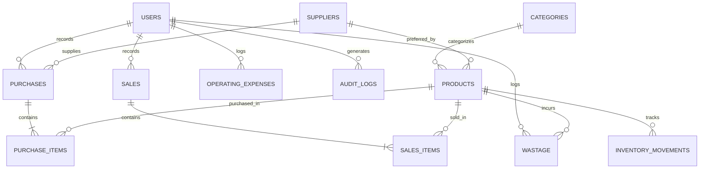

# Oracle Database Schema Specification

## 1. Overview and Oracle 10g Compatibility Rules

The database is built on **Oracle Database 10g Express Edition Release 10.2.0.1.0**. All SQL and PL/SQL code adheres strictly to the following Oracle 10g standards:
- **No 12c `IDENTITY` Columns:** Primary keys are generated using sequences (`CREATE SEQUENCE ...`) combined with `BEFORE INSERT OR UPDATE` triggers.
- **No 12c `FETCH FIRST n ROWS ONLY`:** Top-n queries use the standard `ROWNUM` subquery pattern:
  ```sql
  SELECT * FROM (SELECT ... ORDER BY col DESC) WHERE ROWNUM <= 5;
  ```
- **Explicit Sequence Calling:** Sequences are fetched inside PL/SQL triggers using `SELECT seq.NEXTVAL INTO :new.id FROM dual;` (compatible with Oracle 10g).
- **Escaping Ampersands:** Scripts contain `SET DEFINE OFF;` to prevent SQL*Plus from interpreting `&` in strings (e.g. `'Dairy & Bakery'`) as interactive substitution variables.

---

## 2. Entity-Relationship Diagram



---

## 3. Relational Table Definitions

### 3.1 `USERS`
Stores application user accounts, hashed credentials, and role assignments.
| Column | Type | Constraints | Description |
|---|---|---|---|
| `USER_ID` | NUMBER | PK | Unique user identifier (Sequence generated) |
| `USERNAME` | VARCHAR2(50) | NOT NULL, UNIQUE | Login handle (e.g., `admin`, `staff`) |
| `PASSWORD_HASH` | VARCHAR2(255) | NOT NULL | Scrypt hashed password |
| `FULL_NAME` | VARCHAR2(100) | NOT NULL | Display name |
| `ROLE` | VARCHAR2(20) | CHECK IN ('ADMIN', 'STAFF') | Role-based authorization |
| `STATUS` | VARCHAR2(20) | DEFAULT 'ACTIVE' | Account status ('ACTIVE', 'INACTIVE') |
| `CREATED_AT` | DATE | DEFAULT SYSDATE | Account creation timestamp |

### 3.2 `CATEGORIES`
Product categories (e.g., Vegetables, Fruits, Groceries, Dairy & Bakery).
| Column | Type | Constraints | Description |
|---|---|---|---|
| `CATEGORY_ID` | NUMBER | PK | Unique category identifier |
| `CATEGORY_NAME` | VARCHAR2(100) | NOT NULL, UNIQUE | Category title |
| `DESCRIPTION` | VARCHAR2(255) | NULL | Purpose and scope |
| `IS_ACTIVE` | NUMBER(1) | DEFAULT 1 | 1=Active, 0=Inactive |

### 3.3 `SUPPLIERS`
Wholesale vendors supplying fresh produce and FMCG goods.
| Column | Type | Constraints | Description |
|---|---|---|---|
| `SUPPLIER_ID` | NUMBER | PK | Unique supplier identifier |
| `SUPPLIER_NAME` | VARCHAR2(100) | NOT NULL | Vendor business name |
| `CONTACT_PERSON`| VARCHAR2(100) | NULL | Primary contact |
| `PHONE` | VARCHAR2(20) | NULL | Telephone / Mobile number |
| `EMAIL` | VARCHAR2(100) | NULL | Vendor email |
| `ADDRESS` | VARCHAR2(255) | NULL | Physical address / Mandi location |

### 3.4 `PRODUCTS`
Master inventory item catalog with moving weighted-average costs.
| Column | Type | Constraints | Description |
|---|---|---|---|
| `PRODUCT_ID` | NUMBER | PK | Unique product identifier |
| `PRODUCT_CODE` | VARCHAR2(30) | NOT NULL, UNIQUE | SKU / Barcode code (e.g., `VEG-TOM-01`) |
| `PRODUCT_NAME` | VARCHAR2(100) | NOT NULL | Item name (e.g., `Tomato Local`) |
| `CATEGORY_ID` | NUMBER | FK -> CATEGORIES | Category link |
| `UNIT` | VARCHAR2(20) | NOT NULL | Unit of measure (`kg`, `g`, `Piece`, `Bunch`) |
| `PURCHASE_COST` | NUMBER(10,2) | DEFAULT 0 | Moving weighted-average purchase cost |
| `SELLING_PRICE` | NUMBER(10,2) | NOT NULL | Active consumer retail price |
| `CURRENT_STOCK` | NUMBER(10,2) | DEFAULT 0 | Real-time on-hand physical inventory |
| `REORDER_LEVEL` | NUMBER(10,2) | DEFAULT 10 | Safety threshold for replenishment alerts |
| `PREFERRED_SUPPLIER_ID` | NUMBER | FK -> SUPPLIERS | Primary vendor |
| `IS_ACTIVE` | NUMBER(1) | DEFAULT 1 | 1=Active, 0=Deactivated (preserves history) |

### 3.5 `PURCHASES` & `PURCHASE_ITEMS`
Multi-item inward shipment receipt headers and line items.
- Headers track: Reference number, Purchase Date, Supplier, Total Amount, Payment Status (`PAID`, `PENDING`), Notes.
- Line items track: Product, Inward Quantity, Unit Purchase Cost, Line Total. Automatically triggers moving weighted-average cost update and posts an inward entry to `INVENTORY_MOVEMENTS`.

### 3.6 `SALES` & `SALES_ITEMS`
End-of-day fast table closing entries.
- Headers track: Batch Reference (`SALE-YYYYMMDD-XXXX`), Business Date, Total Quantity, Total Revenue, Total Cost of Goods Sold (COGS), Total Gross Profit, Notes, Status (`FINAL`, `DRAFT`, `REVERSED`).
- Line items track: Product, Quantity Sold, Unit Selling Price, Unit Cost Basis at time of sale, Line Revenue, Line COGS, Line Gross Profit. Deducts stock and posts an outward entry to `INVENTORY_MOVEMENTS`.

### 3.7 `INVENTORY_MOVEMENTS` (Double-Entry Stock Ledger)
Perpetual journal recording all stock changes:
| Column | Type | Description |
|---|---|---|
| `MOVEMENT_ID` | NUMBER | PK |
| `PRODUCT_ID` | NUMBER | FK -> PRODUCTS |
| `MOVEMENT_DATE`| DATE | Timestamp of occurrence |
| `MOVEMENT_TYPE`| VARCHAR2(30) | `OPENING_STOCK`, `PURCHASE`, `SALE`, `WASTAGE`, `ADJUSTMENT`, `SALE_REVERSAL`, `PURCHASE_REVERSAL` |
| `QUANTITY_CHANGE` | NUMBER(10,2) | Positive for additions, negative for reductions |
| `BALANCE_AFTER`| NUMBER(10,2) | Resulting on-hand stock balance |
| `UNIT_COST` | NUMBER(10,2) | Cost basis applied |
| `REFERENCE_TYPE`| VARCHAR2(50) | Table origin (`PURCHASE_ITEMS`, `SALES_ITEMS`, `WASTAGE`) |
| `REFERENCE_ID` | NUMBER | Originating record ID |
| `NOTES` | VARCHAR2(255)| Explanatory justification |

### 3.8 `WASTAGE`
Perishable decay, shrinkage, and quality rejections.
- Tracks: Product, Date, Quantity, Unit Cost, Total Loss (`QUANTITY * UNIT_COST`), Reason (`Spoilage`, `Damage`, `Unsold Perishable`, `Quality Rejection`), Notes.

### 3.9 `OPERATING_EXPENSES`
Store overheads: Rent, electricity, employee wages, packaging, transport.
- Tracks: Expense Date, Category, Amount, Description, Recorded By.
