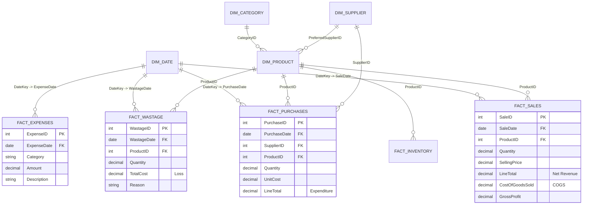

# Power BI Star Schema Data Model Specification

## 1. Reporting Architecture Overview
This reporting architecture establishes a Star Schema model fed directly by analytical datasets extracted from Oracle 10g XE. Fact tables capture distinct transactional events, while shared conformed dimensions prevent double-counting across sales, purchases, and wastage.

---

## 2. Table Schemas & Source Mapping

### Dimension 1: `Dim_Product`
- **Source:** `product_performance.csv` / `PRODUCTS` table
- **Columns:**
  - `PRODUCT_ID` (Key, Integer)
  - `PRODUCT_CODE` (String, e.g., 'VEG-001', 'FRU-001', 'GRO-001')
  - `PRODUCT_NAME` (String)
  - `CATEGORY_NAME` (String: 'Vegetables', 'Fruits', 'Groceries', etc.)
  - `UNIT` (String: 'kg', 'g', 'piece', 'bunch', 'packet', 'litre')
  - `PURCHASE_COST` (Currency/Decimal)
  - `SELLING_PRICE` (Currency/Decimal)
  - `CURRENT_STOCK` (Decimal)
  - `REORDER_LEVEL` (Decimal)
  - `CURRENT_AVERAGE_COST` (Currency/Decimal)
  - `STATUS` (String: 'ACTIVE', 'INACTIVE')

### Dimension 2: `Dim_Date`
- **Source:** Generated via DAX Calendar
- **Columns:**
  - `Date` (Date)
  - `Year` (Integer)
  - `Month` (Integer, 1-12)
  - `MonthName` (String: Jan, Feb, Mar...)
  - `Quarter` (String: Q1, Q2, Q3, Q4)
  - `WeekOfYear` (Integer, 1-53)
  - `DayOfWeek` (String: Monday, Tuesday...)

### Fact 1: `Fact_DailySales`
- **Source:** `daily_sales_summary.csv` / `SALES_ITEMS`
- **Columns:**
  - `SALE_DATE` (Date FK)
  - `PRODUCT_ID` (Integer FK)
  - `QUANTITY` (Decimal)
  - `LINE_TOTAL` (Decimal, Revenue)
  - `COST_OF_GOODS_SOLD` (Decimal, Moving Avg COGS)
  - `GROSS_PROFIT` (Decimal)

### Fact 2: `Fact_Purchases`
- **Source:** `PURCHASE_ITEMS`
- **Columns:**
  - `PURCHASE_DATE` (Date FK)
  - `SUPPLIER_ID` (Integer FK)
  - `PRODUCT_ID` (Integer FK)
  - `QUANTITY` (Decimal)
  - `LINE_TOTAL` (Decimal, Expenditure)

### Fact 3: `Fact_Wastage`
- **Source:** `wastage_analysis.csv` / `WASTAGE`
- **Columns:**
  - `WASTAGE_DATE` (Date FK)
  - `PRODUCT_ID` (Integer FK)
  - `QUANTITY` (Decimal)
  - `TOTAL_COST` (Decimal, Spoilage Loss)
  - `REASON` (String: 'Spoilage', 'Damage', 'Unsold Perishable', etc.)

---

## 3. Relationship Rules
1. `Dim_Date[Date] 1:N Fact_DailySales[SALE_DATE]` (Single Direction)
2. `Dim_Product[PRODUCT_ID] 1:N Fact_DailySales[PRODUCT_ID]` (Single Direction)
3. `Dim_Product[PRODUCT_ID] 1:N Fact_Wastage[PRODUCT_ID]` (Single Direction)
4. `Dim_Product[PRODUCT_ID] 1:N Fact_Purchases[PRODUCT_ID]` (Single Direction)
5. `Dim_Supplier[SUPPLIER_ID] 1:N Fact_Purchases[SUPPLIER_ID]` (Single Direction)
